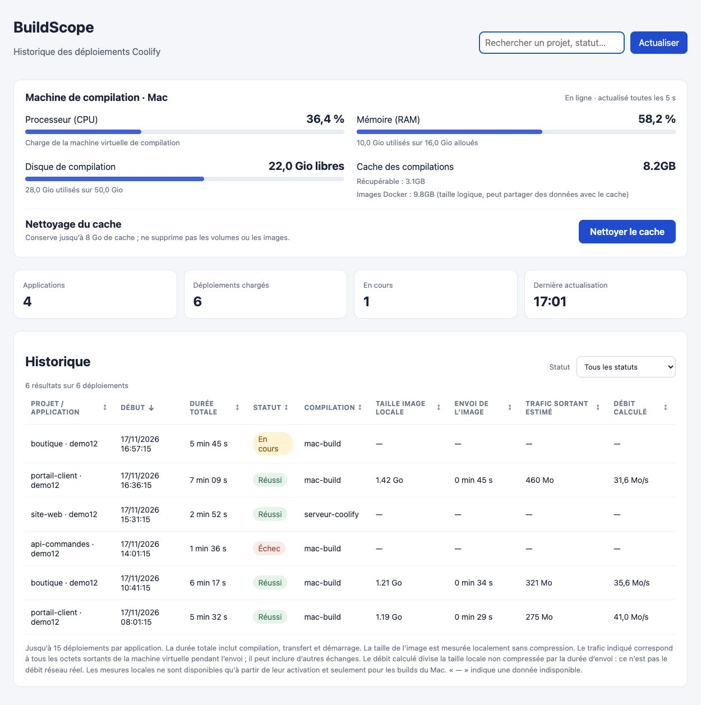
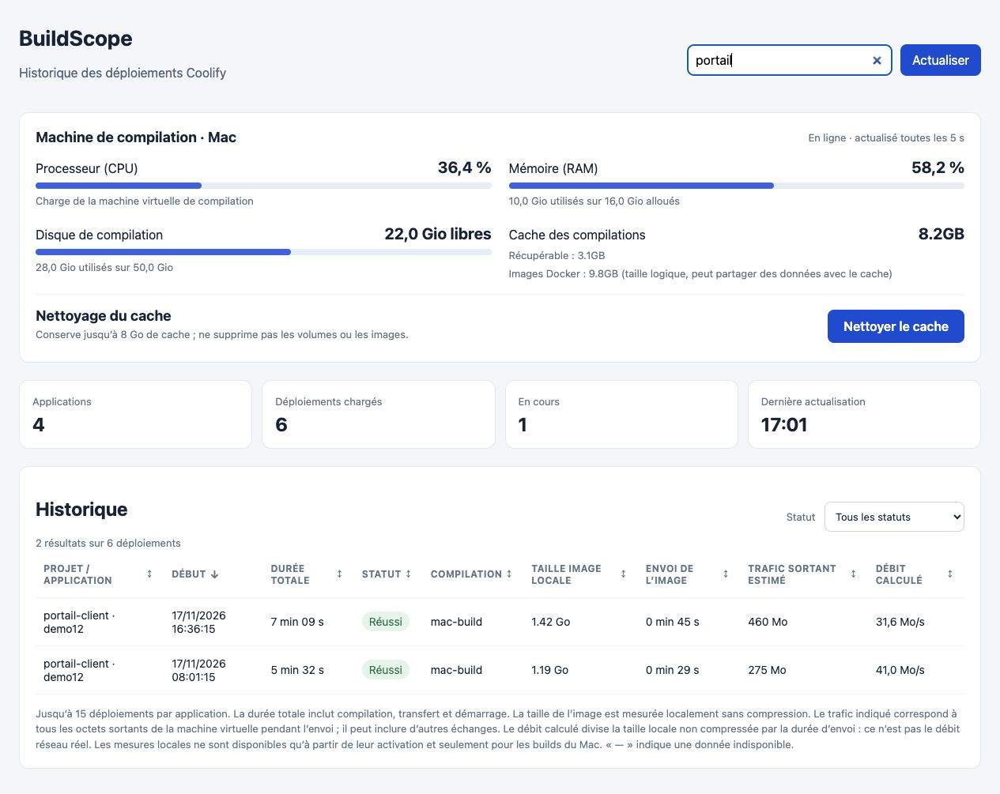

# BuildScope

BuildScope est un tableau de bord local pour suivre les déploiements Coolify et les ressources d'une machine de compilation Colima sur macOS. Il permet de voir les projets en cours, de retrouver les déploiements récents et de surveiller les transferts d'images sans quitter son poste de compilation.



*Capture de démonstration avec des données fictives.*

## Ce que vous pouvez suivre

- Les applications et leurs déploiements récents : statut, date, durée totale et machine de compilation.
- La recherche, le filtre par statut et le tri par colonne pour retrouver un déploiement.
- La consultation et le téléchargement des journaux ; pour un échec, les lignes susceptibles d’expliquer le problème sont mises en évidence.
- Le processeur, la mémoire, le disque disponible et le cache Docker de la VM Colima, actualisés toutes les cinq secondes.
- Lorsque le collecteur optionnel est installé : la taille locale des images, la durée d'envoi et une estimation du trafic sortant pendant le transfert.
- Un débit calculé en divisant la taille locale de l'image par la durée d'envoi, lorsque ces deux mesures sont disponibles.
- Un nettoyage manuel du cache Docker inutilisé, qui conserve jusqu'à 8 Go de cache lorsque possible et ne supprime ni les images ni les volumes.



*Exemple de recherche avec des données fictives.*

## Installation et utilisation

Prérequis : macOS, Python 3, Colima et une VM `colima` démarrée avec Docker. Il faut aussi une instance Coolify accessible et un jeton API disposant de la permission de lecture. La consultation des journaux nécessite aussi la permission `read:sensitive`.

```sh
git clone https://github.com/alainfinck/BuildScope.git
cd BuildScope
```

1. Créez un fichier `settings.json` dans le dossier du projet avec l'adresse HTTPS de votre instance Coolify :

   ```json
   {"coolify_url": "https://coolify.example.com"}
   ```

   Vous pouvez aussi définir la variable d'environnement `COOLIFY_URL`.
2. Dans Coolify, créez un jeton API en lecture seule pour les ressources à suivre et activez l'accès API si nécessaire.
3. Lancez `python3 server.py`, puis ouvrez [http://127.0.0.1:8765/](http://127.0.0.1:8765/). Le fichier `Lancer le suivi.command` permet également de lancer le tableau de bord sur macOS.
4. Saisissez le jeton dans l'interface. Il est conservé dans le Trousseau macOS ; ne l'ajoutez pas aux fichiers du projet.

Le serveur écoute uniquement sur l'interface locale. Les réglages personnels et les secrets ne sont pas versionnés. Le nettoyage du cache est indisponible lorsqu'un conteneur est en cours d'exécution.

## Mesures et limites

Le collecteur optionnel `collector.py` est destiné à fonctionner comme service dans la VM Colima, avec accès à Docker et à `/proc`. Il observe les envois à partir de son démarrage et ne stocke pas les lignes de commande complètes. Sans lui, ou pour les builds exécutés ailleurs, les mesures locales peuvent être indisponibles.

La taille affichée est celle de l'image locale **non compressée**. Le trafic indiqué correspond à l'ensemble du trafic sortant de la VM pendant la commande `docker push` : il peut inclure d'autres échanges. Le débit calculé à partir de la taille locale et de la durée d'envoi est donc un indicateur, **pas une mesure du débit réseau réel**. Les images et le cache Docker peuvent partager des données : leurs tailles ne s'additionnent pas nécessairement.

La durée totale comprend l'attente, la compilation, les transferts et le démarrage. L'historique affiche jusqu'aux 15 derniers déploiements par application. Les valeurs non disponibles sont indiquées par « — ». Les journaux peuvent contenir des données sensibles : vérifiez-les avant de les partager.
